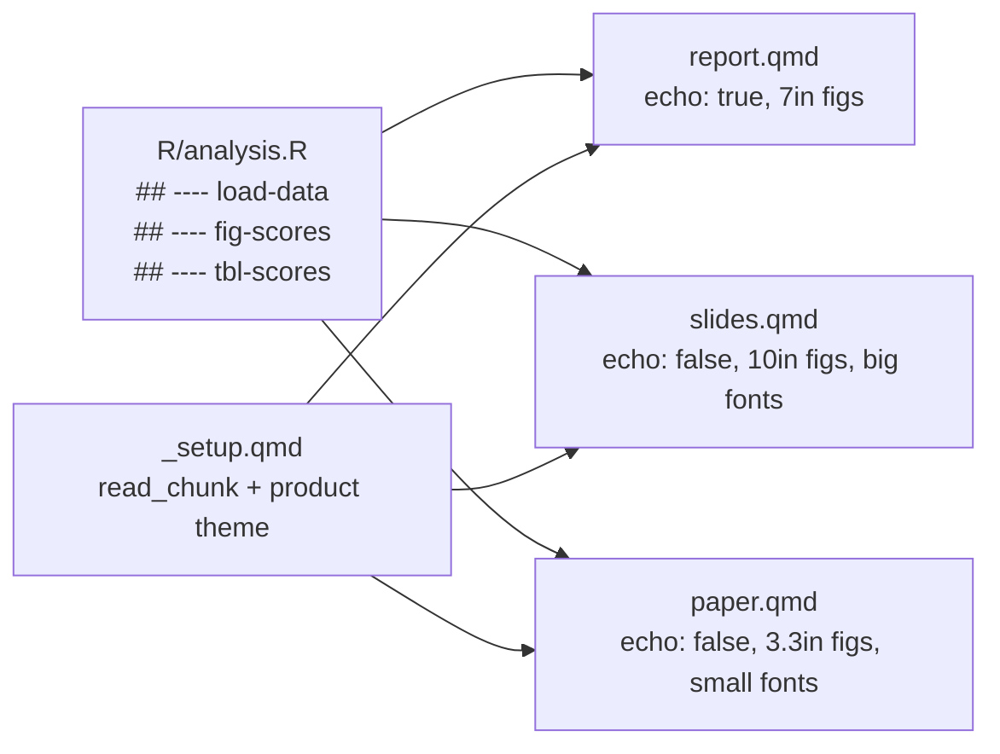

# DRY Quarto: One R Script, Many Products

A workflow for keeping analysis code in one place and reusing it in a **report**, a **slide deck**, and a **paper**, where each product formats figures and tables in its own way and can optionally show the code.

The core tool is `knitr::read_chunk()`. Optional variant: the `#| file:` chunk option.

Tested with Quarto 1.11.9, R 4.6.0, knitr + ggplot2 (November 2026).

---

## 1. The idea in one paragraph

The analysis code lives in plain `.R` script(s) under `R/`. The script is split into labelled sections with `## ---- label` comment lines. Each Quarto document (report, slides, paper) reads the script with `knitr::read_chunk()` and then includes **empty chunks** whose labels match the script sections. knitr fills each empty chunk with the matching code and runs it inside the host document. Because the chunk *header and options* belong to the host document, each product controls its own caption, cross-reference label, figure size, and whether code is shown. The *code* itself exists only once.



## 2. Design principles

1. **Write shared code once, display it per product.** Shared code makes things: data, models, ggplot objects, table *data frames*. Host documents choose how those things look.
2. **Keep product logic out of shared code whenever possible.** Never put `theme_*()`, font sizes, or figure dimensions in the script. These come from the host document. The code readers see is then clean and identical everywhere.
3. **Product ≠ output format.** A report and a paper may both be PDF (or both HTML), so you can't tell which product you're building by checking the format (`knitr::is_latex_output()`, etc.). Each document declares its product explicitly with `params: product:`.
4. **The host owns the chunk header.** Label, caption, size, `echo`, and `include` are set in the `.qmd`, never in the script.

## 3. Project structure

```
project/
├── project.Rproj          # makes here::here() find the root
├── _quarto.yml            # project-wide options (e.g., freeze)
├── _setup.qmd             # shared setup chunk; leading _ = not rendered on its own
├── R/
│   ├── analysis.R         # labelled sections (## ---- label)
│   └── fig_scores.R       # (optional) one-file-per-chunk variant
├── data/
│   └── scores.csv
├── report.qmd
├── slides.qmd
└── paper.qmd
```

Notes:

- `here::here()` locates the root through the `.Rproj` file (or a `.here` file / git root). It does **not** recognize `_quarto.yml` by itself. Quarto runs each document with its own folder as the working directory, so always build paths with `here::here()`.
- Files starting with `_` are skipped by `quarto render`, which is what you want for include-only files.
- You can use several scripts (e.g., `R/data.R`, `R/models.R`, `R/figures.R`) by calling `read_chunk()` once per script. Labels must be **unique across all scripts** read into a document.

## 4. The shared script

```r
# R/analysis.R

## ---- load-data
library(tidyverse)
d <- read_csv(here::here("data/scores.csv"), show_col_types = FALSE)

## ---- fit-model
m <- lm(score ~ time, data = d)

## ---- fig-scores
ggplot(d, aes(x = time, y = score)) +
  geom_line()

## ---- tbl-scores-data
tbl_scores <- d |>
  group_by(group) |>
  summarize(mean = mean(score), sd = sd(score), n = n())
```

Conventions:

- A section starts at a line `## ---- label` and runs until the next such line (or end of file). Variants like `# ---- label ----` also work. The pattern is dashes around the label.
- **Labels**: use Quarto cross-reference prefixes (`fig-`, `tbl-`) only for sections whose host chunk will actually produce that figure or table. Giving a chunk a `tbl-` label makes Quarto create a numbered "Table N" even if the chunk outputs nothing. Name data-only sections without the prefix (e.g., `tbl-scores-data` above is *not* safe as a host label for that reason; `scores-data` is better).
- Sections run in order in the host document and share one environment. A section can use objects created by earlier sections, but the host must run those earlier sections too.
- The script works on its own: `source("R/analysis.R")` runs everything top to bottom. That makes it easy to develop and debug interactively, and the labels are just comments to R.
- **No theme, size, or font code in the script.** ggplot2 looks up the default theme when the plot is *printed*, not when it is created, so `theme_set()` in the host applies to every plot that doesn't add its own `theme_*()`. (Verified: a plot created under `theme_gray()` and printed after `theme_set(theme_classic(base_size = 9))` uses base size 9.)

## 5. Declaring the product and shared setup

Each document declares its product in YAML:

```yaml
params:
  product: slides   # report | slides | paper
```

You can override it at render time with `quarto render slides.qmd -P product:slides`.

A single setup fragment is included at the top of every document:

````markdown
<!-- _setup.qmd -->
```{r}
#| include: false
library(tidyverse)
knitr::read_chunk(here::here("R/analysis.R"))

theme_set(switch(params$product,
  report = theme_minimal(base_size = 12),
  slides = theme_minimal(base_size = 20),
  paper  = theme_classic(base_size = 9)
))
```
````

In each document, put this right after the YAML:

```markdown

```

`read_chunk()` must run in a chunk **before** the chunks that use its labels. It cannot be in the same chunk.

## 6. Using the code in a host document

Each shared section is pulled in with an **empty chunk** whose label matches. Both label styles work:

````markdown
```{r load-data}
#| include: false
```

```{r fig-scores}
#| fig-cap: "Scores over time."
```

```{r}
#| label: fig-scores
#| fig-cap: "Scores over time."
```
````

Cross-references (`@fig-scores`), captions, and numbering all work as usual because the label belongs to the host chunk.

The three products differ only in their YAML and chunk options:

**report.qmd**

```yaml
---
title: "Scores report"
format:
  html:
    fig-width: 7
    fig-asp: 0.618
    code-fold: true      # code available but collapsed
execute:
  echo: true
params:
  product: report
---
```

**slides.qmd**

```yaml
---
title: "Scores"
format:
  revealjs:
    fig-width: 10
    fig-asp: 0.5
execute:
  echo: false
params:
  product: slides
---
```

**paper.qmd**

```yaml
---
title: "Scores paper"
format:
  pdf:
    fig-width: 3.3     # single journal column
    fig-asp: 0.75
execute:
  echo: false
params:
  product: paper
---
```

Any single chunk can override the document defaults (e.g., `#| fig-width: 6.8` for a full-width figure in the paper, or `#| echo: true` for one chunk on a slide).

## 7. Tables: the compute / display split

Figures adapt almost for free (`theme_set()` + figure-size defaults). Tables do not: table packages (gt, tinytable, kableExtra, flextable) adapt to the *output format* but have no `theme_set()`-style hook for the *product*. Slides usually need fewer columns, fewer digits, and bigger text, and the paper needs journal styling.

**Pattern**: the shared script computes the table **data** (a data frame), and each host has a short display chunk.

````markdown
```{r scores-data}
#| include: false
```

<!-- report.qmd -->
```{r}
#| label: tbl-scores
#| tbl-cap: "Score summary by group."
tinytable::tt(tbl_scores, digits = 2)
```

<!-- slides.qmd -->
```{r}
#| label: tbl-scores
#| tbl-cap: "Score summary"
tinytable::tt(select(tbl_scores, group, mean), digits = 1)
```
````

The display chunk is not DRY, but it is short (2–5 lines), and it genuinely differs by product. All of the analysis that matters is still in one place.

The same split is the escape hatch for figures that need product-specific *content* (not just size/theme). Have the script save the plot object and print it:

```r
## ---- fig-scores
fig_scores <- ggplot(d, aes(x = time, y = score)) + geom_line()
fig_scores
```

The slides can then run `fig-scores` with `#| include: false` and display a variant, e.g., `fig_scores + labs(x = NULL)`.

Avoid `if (params$product == "slides")` inside the shared script. It works, but the branching shows up in the code readers see and spreads product logic across files.

## 8. Showing code

| Goal | How |
|---|---|
| Show code inline (report) | `execute: echo: true` (document) or `#| echo: true` (chunk) |
| Code available but collapsed | `format: html: code-fold: true` |
| Hide code (slides, most papers) | `execute: echo: false` |
| Code appendix at end of paper | One chunk with `ref.label` (below) |

Code appendix:

````markdown
## Appendix: Code

```{r}
#| ref.label: [load-data, fit-model, fig-scores, scores-data]
#| echo: true
#| eval: false
```
````

List the labels explicitly. `#| ref.label: !expr knitr::all_labels()` also works, but (verified) it includes the setup chunk **and every section of the script, even ones the document never used**.

## 9. The `#| file:` variant

Instead of labelled sections, each chunk's code can live in its own file:

````markdown
```{r}
#| label: fig-scores
#| fig-cap: "Scores over time."
#| file: R/fig_scores.R
```
````

| | `read_chunk()` + labels | `#| file:` |
|---|---|---|
| Files | Few scripts, many sections | One file per chunk |
| Run whole analysis interactively | `source()` one script | Need a runner script or several `source()` calls |
| Typo behavior | Silently empty chunk | Error (file not found) |
| Label freedom | Host label must match script label | Any label |

Note that `file:` paths are relative to the document's folder, not the project root.

## 10. Rendering and speed

Every document runs the shared code it uses, so a slow model is refit once per product. Options:

- `_quarto.yml`:

  ```yaml
  project:
    type: default
  execute:
    freeze: auto   # re-run a document only when its source changes
  ```

  Freeze applies to **project-level** renders (`quarto render` with no file argument). Rendering a single file re-executes it. Freeze watches the `.qmd`, **not** `R/analysis.R`: after editing the script, re-render each affected document directly (e.g., `quarto render paper.qmd`), which always re-executes it and updates `_freeze/`.
- knitr `cache: true` on the slow chunk. Again, cache invalidation does not see changes to the external script unless you add the dependency (e.g., `#| cache.extra: !expr tools::md5sum(here::here("R/analysis.R"))`).
- If this becomes painful, move the slow step to a saved object (`.rds`) or to `targets`. The host documents' display code doesn't need to change.

## 11. Common pitfalls (and what students will see)

| Pitfall | Symptom | Fix |
|---|---|---|
| Typo in chunk label / label not in script | **Chunk silently disappears**: no error, no output (verified) | Copy labels exactly; when output is missing, check labels first |
| `read_chunk()` in same chunk as use, or after | Empty chunks | Put it in the setup chunk at the top |
| Forgot to run prerequisite sections | `object 'd' not found` | Include earlier sections with `#| include: false` |
| `tbl-`/`fig-` label on a chunk with no table/figure | Stray "Table 1" / "Figure 1" numbering | Use prefixes only on display chunks |
| `theme_minimal()` hard-coded in script | Slides and paper fonts won't change | Remove it; rely on `theme_set()` in setup |
| Relative paths in the script | Works in console, fails on render (or vice versa) | `here::here()` everywhere |
| Duplicate labels across scripts | The script read last silently wins (verified) | Keep labels unique project-wide |
| Edited script, output unchanged | Stale freeze/cache | Force re-render; see Section 10 |
| Product guessed from format | Report and paper get the same styling | Use `params$product` |

## 12. Teaching notes

**Learning objectives.** Students should be able to:

1. Explain why duplicated analysis code across products causes errors (results drift between the paper and the slides).
2. Structure an analysis script with labelled sections and run it on its own.
3. Pull sections into a `.qmd` with `read_chunk()` and empty chunks.
4. Make figures adapt by product using document-level size defaults and `theme_set()`.
5. Apply the compute/display split for tables.
6. Control code display per product (inline, folded, hidden, appendix).
7. Diagnose the silent-empty-chunk failure.

**Suggested sequence.**

1. *Motivation*: show a paper and slides made by copy/paste, change the data, and watch them disagree.
2. *Script first*: write `R/analysis.R` and run it with `source()`. Add `## ----` labels and show they're just comments.
3. *One host*: build `report.qmd` with `read_chunk()` and empty chunks, `echo: true`.
4. *Second host*: build `slides.qmd` from the same script. Only YAML differs. Point out that the figures already look different.
5. *Product theme*: add `params$product` and `_setup.qmd` with `theme_set()`.
6. *Tables*: add the compute/display split.
7. *Paper*: column-width figures, `echo: false`, code appendix.
8. *Change propagation*: edit one line in the script and re-render all three.

**Exercises.**

- Add a new figure section to the script and use it in all three products with different captions.
- Break a label on purpose. What happens? How would you find it?
- Make a table show 2 digits in the report and 1 in the slides without editing the script.
- Move the theme into the script and observe what breaks. Then explain why ggplot looks up the theme at print time.
- Add a slow model and set up `freeze: auto`. Edit the script and explain why the output did not update.

**Minimal demo checklist** (for building class materials):

- [ ] `.Rproj` at root (for `here`)
- [ ] `R/analysis.R` with `load-data`, one figure section, one table-data section
- [ ] `_setup.qmd` with `read_chunk()` + product `theme_set()`
- [ ] `report.qmd` (html, echo true, code-fold), `slides.qmd` (revealjs), `paper.qmd` (pdf or html, echo false, appendix)
- [ ] Each declares `params: product:`
- [ ] A cross-reference to the figure in each product
- [ ] One display-only table chunk per product
